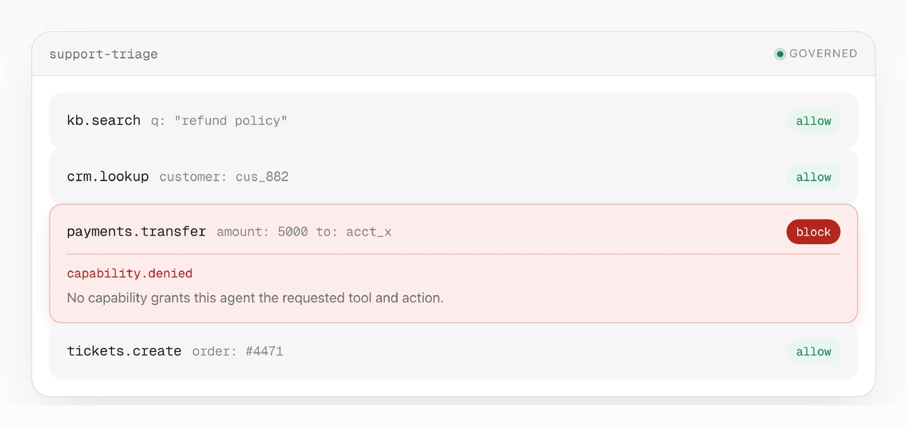

<div align="center">


# AgentFox

**Find, govern and protect every AI agent you run.**
**Guardrails that don't block your real customers.**

Open source. Attack-test your own agent in about three minutes, then watch the same attacks
get stopped. Works with the OpenAI Agents SDK, LangGraph, LangChain, CrewAI, AutoGen,
OpenAI, Anthropic, LiteLLM, MCP servers, Claude Code and Codex.

[](https://github.com/architsharm/agentfox/actions/workflows/ci.yml) [](LICENSE) [](pyproject.toml) [](https://pypi.org/project/agentfox/) [](https://useagentfox.com/playground)

**[▶ Try it in the browser, no account](https://useagentfox.com/playground)** &nbsp;·&nbsp; [Docs](https://useagentfox.com/docs) &nbsp;·&nbsp; [Benchmarks](https://useagentfox.com/benchmark) &nbsp;·&nbsp; [Discussions](https://github.com/architsharm/agentfox/discussions)

If AgentFox is useful to you, a ⭐ helps other people find it.

</div>

<br />

<picture>
  <source media="(prefers-color-scheme: dark)" srcset="docs/assets/hero-dark.webp" />
  
</picture>

## What it does

| | |
|---|---|
| **Discover** | Reads your code (never runs it) and maps every agent, the tools it can call, the MCP servers and skills it loads, and who hands work to whom. |
| **Govern** | Each agent gets only the tools its own code hands it, with limits on the values it may pass (an amount cap, an allowed recipient). Anything else is refused or held for a person. |
| **Protect** | Checks every model and tool call at runtime: prompt injection, instructions hidden in documents and tool results, personal data and secrets leaving in replies. Starts in watch mode, so nothing your users do is blocked until you say so. |
| **Test** | Attacks your real agent with its own tools faked, shows what got through, then shows the same attacks against your guardrails. |
| **Prove** | Every decision lands in a tamper-evident audit trail you can verify without trusting us. |

The part that does not depend on catching the attack: a transfer whose recipient came out of a
retrieved document is refused because of *where the value came from*, not because a detector
recognised the payload.

## Quickstart

Python 3.11 or newer.

### Attack your own agent (about three minutes)

1. [Sign in](https://useagentfox.com/login); signing in creates your workspace. Press
   **Create a key**.
2. In your agent's repository, with its dependencies installed, run the command the page shows:

   ```bash
   pip install -U agentfox
   agentfox init --key nom_api_… --server https://…
   ```

   `init` reads your code without running it and reports the agents and tools it found. Leave it
   running: the attack test runs your agent on your machine, with every tool faked so nothing
   real happens.
3. Press **Add N agents to AgentFox**. The attack test starts by itself and shows, per kind of
   attack, how many got through.
4. Press **Add and test again**. Basic guardrails go on and the same attacks run again, so you
   see the before and after side by side, including how many normal requests were still
   answered.
5. Add the one line `init` prints (`agentfox.auto("<agent>")`) and run your app. Its calls show
   up on the agent's **Activity** tab.

### From the command line only

```bash
pip install agentfox
agentfox scan                    # names every agent it found, ends with: agentfox up
agentfox up                      # registers them, declares their tools, adds agentfox.auto()
python main.py                   # run your app as usual
agentfox findings                # what it saw, and what it would have stopped
agentfox test redteam <agent>    # attack-test it
```

`up` uses the names the code gives your agents, the same names `scan` printed, and adds
`agentfox.auto("<agent>")` to the file that starts one (a `pyproject.toml` script, the graph
`langgraph.json` loads, or the file that runs it, `src/` included), for Python apps on
LangGraph, LangChain, CrewAI, AutoGen, pydantic-ai and the OpenAI Agents SDK. The name is the
agent that file runs (a crew or swarm takes its project's name), shown before anything changes
so you can edit it. In a folder of separate examples it sets up one, with only that agent's
tools, and says how to pick another (`agentfox up --agent <name>`). It starts in watch mode and
changes nothing else by default: coding-agent hooks, the GitHub workflow and the local API are
`--with coding-agents`, `--with ci` and `--with view`. Everything stays on your machine; a pip
install has no web dashboard (`agentfox findings` is the terminal view), which comes with
AgentFox Cloud or the self-hosted stack.

The prompt-injection classifier (PIGuard) is an extra, not part of `pip install agentfox`:

```bash
pip install 'agentfox[classifiers]'
agentfox admin detectors pull injection.classifier   # downloads the model weights once
```

Without it, injection checks use the pattern-based detector only, alongside the PII, secrets
and hidden-Unicode checks and tool containment, all of which work on a plain install.
`agentfox doctor` says which detectors run on your machine, and `auto()` says once that the
classifier is skipped rather than on every run. The Docker image ships the extra and the
weights.

### One key everywhere

```bash
export AGENTFOX_URL=https://…
export AGENTFOX_API_KEY=nom_api_…
```

With these set (or `.agentfox/agentfox.env`, or `agentfox.auto(server=…, key=…)`),
every check `agentfox.auto()` makes goes to your account's gateway and the calls appear
on the dashboard. Without a key it checks and records locally. Every OpenAI, Anthropic,
LiteLLM and LangChain call in the process is checked, and every tool call in a response
is checked before your code can run it; a refused one raises `agentfox.Blocked`.

### Other ways in

- **Check your machine (about 2 seconds):** `agentfox scan machine` reads the MCP configs
  and skills that Claude Code, Cursor, Claude Desktop, VS Code, Windsurf, Gemini CLI and
  Codex load. Nothing is started, written or sent. Without installing:
  `uvx agentfox scan machine`.
- **Your coding agent:** in a project where you use Claude Code or Codex,
  `agentfox up --with coding-agents` writes the hooks, grants the agent its built-in tools
  and starts in watch mode, except shapes such as `rm -rf ~/`, which are refused from the
  start. In a repository set up for a coding agent with no agent of its own, `agentfox up`
  does this by default. The hooks call AgentFox by absolute path, so they work from a
  virtualenv install too.
- **Behind a LiteLLM proxy:** one block in the proxy's `config.yaml` checks every agent
  behind it ([guide](https://useagentfox.com/docs/guides/litellm)).
- **Look around first:** `agentfox init && agentfox demo`. `init` creates a SQLite database
  and loads 44 controls and the policy packs in about a second; `demo` runs a thirteen-step
  walkthrough in about five, in a database of its own (`~/.agentfox/demo.db`), so your
  project's `agentfox findings` never shows the demo's made-up agents. Both are offline: no
  API key, no downloaded weights, no network egress.
- **Scan this directory without installing:**
  `curl -fsSL https://raw.githubusercontent.com/architsharm/agentfox/main/scripts/quickscan.sh | bash`
  installs the published release into a throwaway virtualenv (`| bash -s -- --main` for the
  current main).
- **On every pull request:** the GitHub Action annotates lethal trifectas, ungoverned model
  calls and poisoned skills, and fails the check on the kinds you list in `fail-on`:

  ```yaml
  - uses: actions/checkout@v4
  - uses: architsharm/agentfox@main
    with:
      fail-on: trifecta,skills
  ```

## Contain a tool call

Any language can ask the gateway about one call before running it:

```bash
agentfox serve                              # gateway + control-plane API on 127.0.0.1:8080
agentfox admin users create you@example.com --token   # first operator + API token, shown once

curl -s -X POST http://localhost:8080/v1/guard/tool_call \
  -H "Authorization: Bearer $AGENTFOX_API_KEY" -H "Content-Type: application/json" \
  -d '{"agent":"payments-ops","tool":"payments.transfer",
       "arguments":{"amount":250,"currency":"USD","to":"acct_991"},
       "provenance":{"to":"tool_result","amount":"user"},
       "intent":"refund a duplicate charge"}' | jq '{verdict, approval_id}'
```

```json
{ "verdict": "escalate", "approval_id": "apr_01m376q43zby33tbsp" }
```

The recipient came from a tool result, so the transfer waits for a human. Flip `"to"` to
`"user"` and the same call returns `allow`. Once a person approves it
(`agentfox permit approvals approve apr_…`), the same call with `"approval_id"` added runs, once.
Pointed at `/v1` as an OpenAI or Anthropic base URL, the gateway proxies model calls too, and a held
one returns HTTP 428 with its `approval_id`.
LangGraph, MCP, Claude Code hooks, the SDK and the
full command set are in the [website guides](https://useagentfox.com/docs) and the
[product tour](docs/product-tour.md).

## Tracking without anyone running a command

A scan is a snapshot. Connect a GitHub repository, a hosted API's OpenAPI document or an MCP server
once and AgentFox keeps re-checking it: every few hours, and on every push once the GitHub webhook
is registered. What changed since the last run becomes a finding, and the finding closes itself
when the condition clears. Setup and every finding type:
[Monitor connected sources](https://useagentfox.com/docs/guides/monitoring).

## What we measured

The detector comparison behind these numbers is peer reviewed: *No Tier Wins Everywhere*, accepted
at WAITI 2026, a workshop of ACSAC 2026 ([artifact](https://github.com/architsharm/waiti2026-artifact)).

We do not claim adversarial robustness, and we do not believe anyone can.
[*The Attacker Moves Second*](https://arxiv.org/abs/2510.09023) (Nasr, Carlini, Schulhoff et al.,
2025) reports over 90% attack success against twelve published defences once the attacker adapts.
So the number we lead with does not depend on catching anything: both rows below were measured
with **every detector switched off**.

| Evidence | Result |
|---|---|
| [Containment under total detector bypass](benchmarks/containment/README.md) | **8/8 attacks contained with zero detector signal**; 4/4 legitimate calls still allowed |
| [AgentDojo, replayed end to end](benchmarks/agentdojo/README.md): 97 user tasks and 949 attack pairs, with argument provenance inferred from the real tool outputs | **588/588 attack pairs contained** with session-level taint, but only **24/97 benign tasks (24.7% [17.2, 34.2]) run without escalating to a human**. Per-argument taint: 37/97 benign tasks, 527/588 attack pairs contained. Taking provenance from the benchmark's own labels gives 97/97 and 588/588; that is an upper bound, not a measurement |

The cost is benign utility: when provenance is inferred, a legitimate action that copies a
value out of a tool output looks the same as an attack, and it is escalated.

**Optionally, detection gets better.** The judgment tiers are off by default; with them on,
agentfox catches 160/165 of the injection payloads that defeated our own pattern detectors, at
94.7% precision against the [NotInject](benchmarks/generalization/data/README.md) over-defense
set. [What each tier is worth, and what it costs](benchmarks/judgment/README.md).

## Where we are still improving

Detection is the layer we trust least, so we publish its numbers.

- The default injection stack (heuristic plus the PIGuard classifier) has a held-out recall of
  **68.3%**, at 100% precision ([REPORT.md](benchmarks/REPORT.md)). It needs
  `agentfox[classifiers]` and the model weights, which the Docker image ships; without them the
  heuristic runs alone, and its held-out injection recall is **16.7%**; the startup warning and
  `agentfox doctor` say so.
- On NotInject, 339 benign prompts built to trip keyword guardrails, the classifier flags
  11.5% (39/339) at the level an enforcing policy acts on (PIGuard alone), and 41% (140/339)
  counting the advisory backstop hits that observe mode records.
- An [adaptive attacker](benchmarks/adaptive/README.md) that reads our verdict and retries gets
  **74% of the attacks we catch through within 50 attempts**, measured against the
  heuristic-only stack that was the default until October 2026.
- The deterministic answerability classifier abstains on 57/676 contested questions; with a
  judgment tier that becomes 572/676, at the cost of over-refusal rising from 0.75% to 6.8%.
- Against a real, independently installed `llm-guard` on indirect injection via tool output, it
  is more precise than us: **81.8% against our 66.7%** on the same 20 cases, though of the 10
  attacks among them we catch all 10 and it catches 9. That run predates October 2026, while the
  backstop model's hits still counted toward a block
  ([agent_security](benchmarks/agent_security/README.md)).
- On AgentDojo, per-argument taint misses 61 of 702 attacker write calls; session-level taint
  misses none of them and escalates three in four benign tasks.
- The default stack reaches 86.4% and 98.4% recall on two independent datasets (SPML and
  yanismiraoui), but on long prompts (around 2,000 characters and up) the classifier mostly
  times out within its 250 ms budget and the request falls back to the heuristic.

Treat every detection number as a speed bump that raises attacker cost, never as a defence.

## Not built yet

- **It is only as good as your declarations.** A destructive tool declared `read` is treated
  as `read`. `agentfox doctor` grades this; `agentfox scan` finds undeclared tools.
- **You declare the estate yourself.** No Okta, no DataHub; principals and grants live in AgentFox.
- **Compliance mappings are DRAFT**, not reviewed by counsel, and labelled so in every export.
- **No live IdP or SSO.** Multi-tenancy is enforced at the session within one deployment, and only text is inspected.

Live per-capability status, computed by probe: [docs/status.md](docs/status.md).

## Documentation

| | |
|---|---|
| [Website docs](https://useagentfox.com/docs) | Install, guides for every integration, and the CLI, API and config reference |
| [Getting started](docs/getting-started.md) | The short path, then a linear first hour ending with your own agent governed |
| [Product tour](docs/product-tour.md) | The reference view: every integration surface, commands by task, the demo output, self-hosting |
| [ARCHITECTURE.md](ARCHITECTURE.md) | The domain model, a tool call traced through the code, and the code map |
| [CONTRIBUTING.md](CONTRIBUTING.md) | Setup in three commands, `just ci`, and the conventions |
| [docs/](docs/README.md) | Design, threat model, requirements and how the numbers were measured |
| [Benchmarks](benchmarks/README.md) | Every number above, with the script that reproduces it |
| [SECURITY.md](SECURITY.md) | Report a vulnerability privately; please not in a public issue |

Questions and ideas go to [Discussions](https://github.com/architsharm/agentfox/discussions);
bugs to [Issues](https://github.com/architsharm/agentfox/issues/new/choose). New contributors:
start with a [good first issue](https://github.com/architsharm/agentfox/labels/good%20first%20issue).

## Licence

The open core is [Apache-2.0](LICENSE): the SDKs, the gateway and CLI, enforcement and
containment, every detector and validator, custom rules, policy packs, the benchmarks and the
dashboard. It runs on its own, with no licence key and no limit on agents.

[AgentFox Enterprise](ee/README.md) (`ee/`) adds what an organisation needs to govern many
agents and prove it: compliance status against EU AI Act, ISO 42001, SOC 2 and NIST AI RMF,
auditor evidence packages, fleet monitoring with alerts, and checks against your own access
control. It is source-available under the [Business Source License 1.1](ee/LICENSE): free in
production for one workspace with up to four agents, and **each release becomes Apache-2.0
three years after it ships**. It is included on AgentFox Cloud.
